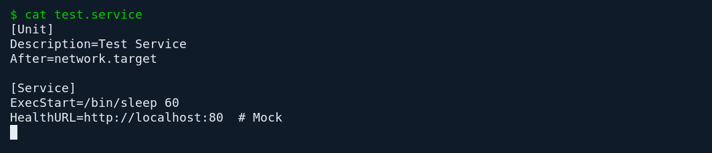
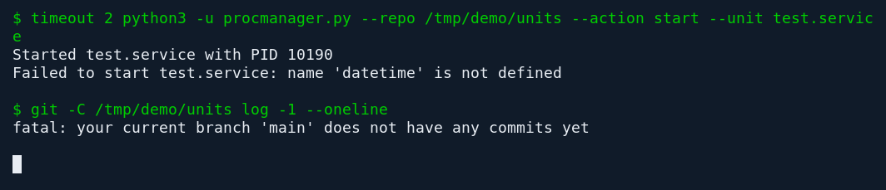

# Process Manager

Менеджер читает поля ExecStart и After из файлов .service, запускает процессы и отслеживает их состояние в памяти. В комплект входит тестовая служба, которая выполняет sleep.



*Файл тестовой службы*



*Запуск службы и запись в журнале Git*

## Запуск

Понадобятся Linux, Python 3 и Git с настроенным автором коммитов.

```bash
units=$(mktemp -d)
cp test.service "$units/"
python3 procmanager.py --repo "$units" --action start --unit test.service
```

## Что проверено

Проверены чтение файла службы, запуск процесса и создание первого коммита. PID хранится в памяти менеджера, поэтому отдельный вызов CLI не восстанавливает состояние уже запущенного экземпляра.

## Авторство

Вячеслав Георгиевич Кузнецов. GitVerse, задание 3.
